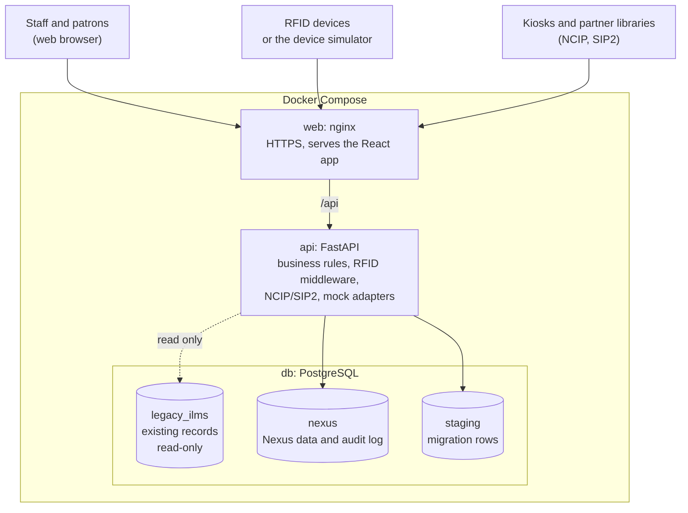

# Nexus — RFID-Enabled Library Solution

Nexus adds RFID to an existing library management system. Staff can tag books, issue and return them, check shelves with a handheld reader, catch unissued books at the exit gate, and sign in with a smart card. It also provides reports, a spreadsheet migration tool, and offline install, update and rollback.

The one firm rule: **existing library records are never changed, deleted or corrupted.**

There is no real hardware in this project. Every device and outside service (RFID readers, gates, CCTV, email, SMS, the old library system) has a working mock, and a device simulator stands in for the readers. All data is synthetic.

## What it does

| Area | Features |
|---|---|
| Cataloguing and search | Books and copies, barcodes, spine labels, full-text search, a public catalogue (OPAC), a virtual bookshelf |
| Circulation | Issue, renew and return, with rules per member category (loan days, item limits, fines); reference books and blocked members are refused |
| RFID | Tag a copy, scan a shelf with a handheld (finds missing and misplaced books), security gate alarm with a camera snapshot and email alert |
| Sign-in | Username and password, or a staff smart-card tap; five roles: Admin, Librarian, Circulation Clerk, Auditor, Patron |
| Partner systems | NCIP and SIP2 interfaces for self-check kiosks and other libraries |
| Reports | Live dashboard and filterable reports, exportable as CSV or PDF |
| Migration | Import a 20,000-row spreadsheet: validate, remove duplicates, commit in one step, reconcile the counts |
| Operations | Backup and restore, a check that proves the old data is unchanged, offline install, update and rollback |

## Screenshots

<table>
  <tr>
    <td width="50%" valign="top"><br><sub>Dashboard with live statistics</sub></td>
    <td width="50%" valign="top"><br><sub>Circulation desk refusing a reference book</sub></td>
  </tr>
  <tr>
    <td width="50%" valign="top"><br><sub>Tagging a book with an RFID tag</sub></td>
    <td width="50%" valign="top"><br><sub>Security gate alarm with camera snapshot</sub></td>
  </tr>
  <tr>
    <td width="50%" valign="top"><br><sub>Shelf inventory: found, misplaced and missing books</sub></td>
    <td width="50%" valign="top"><br><sub>Loans made through NCIP and SIP2 at the desk</sub></td>
  </tr>
  <tr>
    <td width="50%" valign="top"><br><sub>Staff sign-in waiting for a smart-card tap</sub></td>
    <td width="50%" valign="top"><br><sub>Migration batches: 20,000 rows imported</sub></td>
  </tr>
</table>

## Architecture



- **web:** nginx terminates HTTPS, serves the React user interface and passes `/api` requests to the API.
- **api:** one FastAPI application. Routers handle HTTP; services hold the rules; adapters connect to devices and outside services, mocked here.
- **db:** PostgreSQL with three schemas. The application's database account can only **read** `legacy_ilms`, so the old records are protected by the database itself, not just by the code.

**Technology:** Python 3.12, FastAPI, SQLAlchemy, Alembic, React, TypeScript, Vite, Tailwind CSS, PostgreSQL 16, Docker Compose.

## How it works

**A book being issued**

1. A clerk scans the member card and the book at the circulation desk.
2. The API checks the member's category rules: loan limit, fines, member status, reference-only items.
3. If allowed, it records the loan, clears the tag's security bit and writes an audit entry. If not, the desk shows the reason.
4. A self-check kiosk using NCIP or SIP2 goes through the same rules.

**A book leaving through the gate**

1. The gate reader sends the tag it saw to the API.
2. The API checks whether that copy is on loan.
3. If it isn't, the API raises an alarm, attaches a camera snapshot, queues an email alert and shows it live on the Gate monitor screen.

**A spreadsheet migration**

1. **Upload:** every row is stored untouched in `staging`.
2. **Validate:** each row is checked against the rules, and duplicates are marked. Nothing reaches the catalogue yet.
3. **Commit:** a backup is taken first, then all valid rows are added in one transaction. A fingerprint of the old records is compared before and after; any change cancels the batch.
4. **Reconcile:** source rows = valid + rejected + duplicates. A batch can also be rolled back on its own.

## Getting started

You need Docker Desktop (Linux containers) and Git. Use Git Bash on Windows.

```bash
cp .env.example .env              # then replace every placeholder value
sh ops/nginx/gen-cert.sh          # self-signed certificate for local HTTPS
docker compose -f docker-compose.yml -f docker-compose.dev.yml up -d --build
docker compose exec api python -m app.db.seed --legacy 2000 --demo
docker compose cp api:/app/ops/demo-credentials.txt ops/demo-credentials.txt
```

- Open https://localhost:8443 and accept the self-signed certificate.
- Sign-in details for each role are in `ops/demo-credentials.txt`, which is generated on your machine and never committed.
- API documentation is at https://localhost:8443/api/docs.

To act as an RFID device, use the simulator:

```bash
python device-sim/sim.py heartbeat --all
python device-sim/sim.py gate --gate GATE-01 --epc <tag EPC> --direction out
```

## Running the tests

```bash
bash ops/ci-local.sh
```

This runs formatting, lint, type and security checks, dependency audits, and all tests: backend, simulator, migration tools and frontend. The same steps run in GitHub Actions.

## Project structure

| Folder | Contents |
|---|---|
| `backend/` | FastAPI application and its tests |
| `frontend/` | React user interface |
| `device-sim/` | RFID device simulator |
| `migration/` | Spreadsheet import tool and sample data generator |
| `ops/` | Install, update, rollback, backup, restore and integrity scripts |
| `docs/` | Requirements, design, testing, deployment and operations documents |

## Development workflow

The project was built stage by stage, following a software development SOP:

| Stage | Focus |
|---|---|
| 1 | Initiation and controls |
| 2 | Requirements and design |
| 3 | Foundation: auth, roles, audit, database, pipeline |
| 4 | Core library functions |
| 5 | RFID middleware and integrations |
| 6 | Migration and data safety |
| 7 | Verification |
| Release | Deployment, operations and demo documents |

Each stage was:
1. built on its own `stage/N-*` branch
2. reviewed in a gate record in [`docs/00-project-control/stage-gates/`](docs/00-project-control/stage-gates/)
3. merged into `main` and tagged `sop-stage-N`

Bugs were fixed on `fix/DEF-NNN-*` branches and are listed in the [defect log](docs/00-project-control/defect-log.md).

## Documentation

| Topic | Where |
|---|---|
| Requirements and traceability | [`docs/01-requirements/`](docs/01-requirements/) |
| Architecture and design decisions | [`docs/02-design/`](docs/02-design/) |
| Database and migration | [`docs/05-data-migration/`](docs/05-data-migration/) |
| Tests and results | [`docs/06-testing/`](docs/06-testing/) |
| Installation and configuration | [`docs/07-deployment/`](docs/07-deployment/) |
| Administration, user and API guides | [`docs/08-operations/`](docs/08-operations/) |
| Known limitations and production backlog | [`docs/09-limitations-and-backlog/`](docs/09-limitations-and-backlog/) |
| Release history | [RELEASE-NOTES.md](RELEASE-NOTES.md) |
