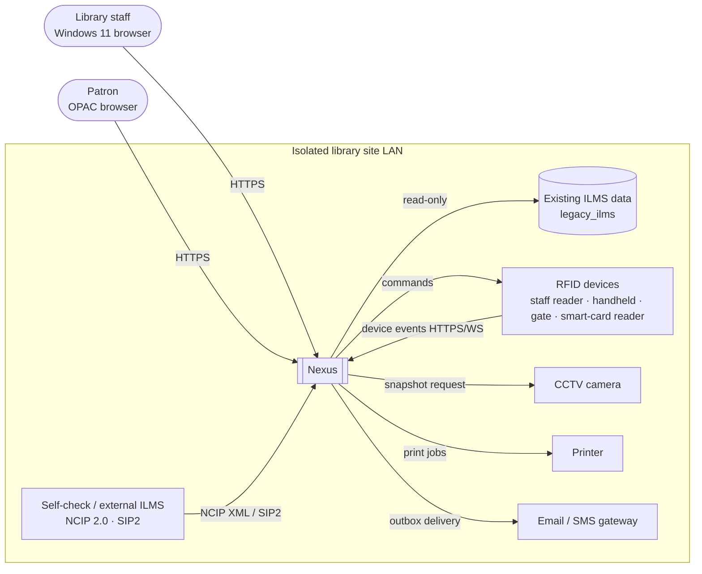
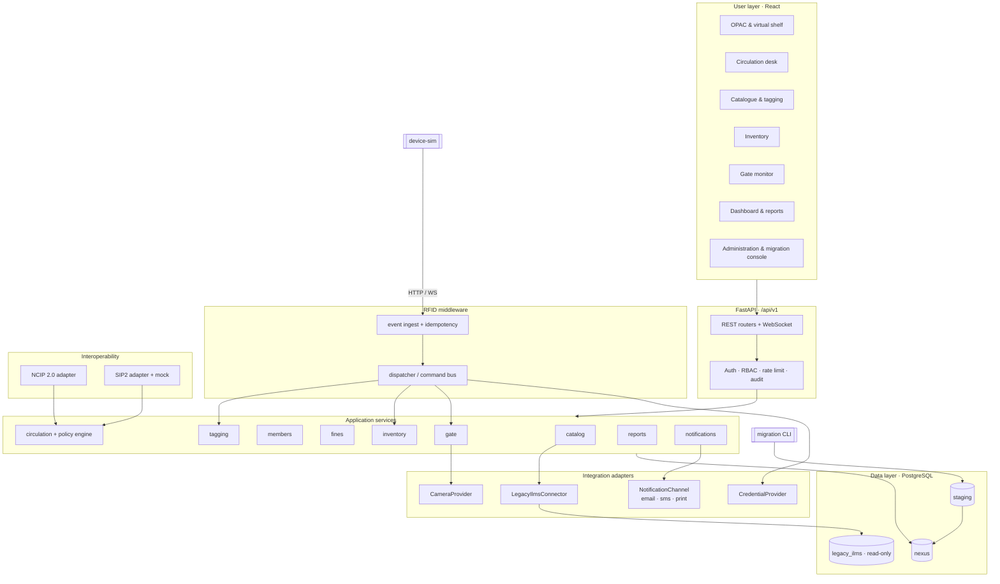
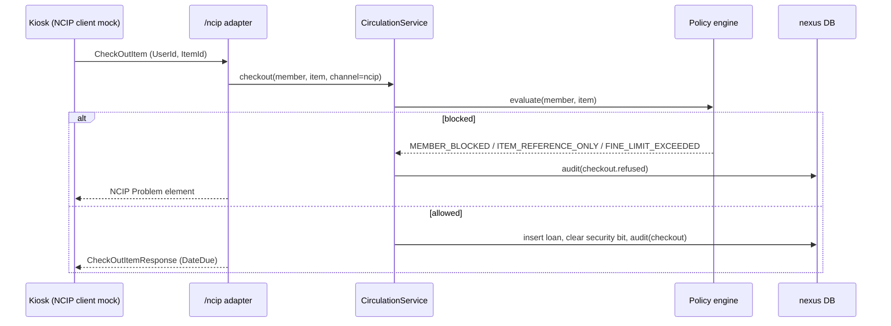
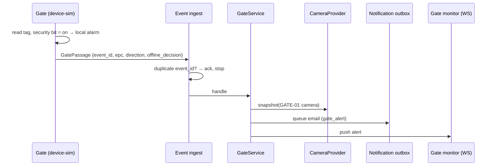
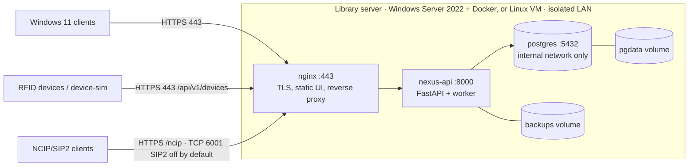

# Architecture

This document covers the context, component and deployment views required by D2. The database, interface and security designs are in their own documents in this folder.

## 1. Goals and constraints

- **Never modify existing ILMS records** (NFR 01). Integrity is enforced in the database, not just in code.
- **Mock everything that isn't available.** Every device or external system sits behind an adapter interface with a working mock, chosen by configuration (NFR 06).
- **Run fully offline** on an isolated site, including install, update and rollback (FR 12, NFR 03).
- **Fit a 48-hour build by one developer.** Hence one deployable backend with strict internal module boundaries, not microservices (ADR-0001).

## 2. Context view

In the prototype, every box outside Nexus is either a mock adapter inside the backend or the separate `device-sim` process.

## 3. Layered component view (SOP §6)

| SOP layer | Nexus components | Code location |
|---|---|---|
| User layer | Staff web UI, OPAC, dashboard, reports, administration | `frontend/` |
| Application layer | Catalogue, circulation, members, fines, inventory, notification, reporting, access-control services | `backend/app/services/`, `backend/app/core/auth` |
| RFID middleware | Device registry, event ingest and dispatcher, command bus, handlers for tagging, inventory, gate and smart card | `backend/app/middleware_rfid/` |
| Interoperability | NCIP 2.0 adapter (subset), SIP2 adapter boundary and mock | `backend/app/interop/` |
| Data layer | PostgreSQL transactional schemas, full-text index, audit log, staging area, backup/restore | `backend/app/db/`, `ops/` |
| Integration layer | Email, SMS and print channels, CCTV camera provider, credential provider, legacy ILMS connector | `backend/app/integrations/` |
| Operations layer | Configuration, secrets, offline installer, structured logs, health checks, update, backup, rollback | `backend/app/core/config`, `ops/` |

**Rules for module boundaries:**
- Routers stay thin: they validate input, check permissions and call one service method.
- Services own transactions and write the audit entries.
- Handlers in the middleware call services and never touch the database directly.
- Adapters are reached only through their interface. The concrete class is picked by `integrations/registry.py` from configuration.
- Circulation has one implementation. The UI, NCIP and SIP2 all call `CirculationService`, so the rules (AC 04) and auditing (AC 03) behave the same on every channel.

## 4. Key runtime flows

**Check-out via NCIP (AC 03, AC 04)**

**Gate alarm (AC 06)**

## 5. Deployment view

| Container | Image | Ports | Notes |
|---|---|---|---|
| `web` | `nexus-web:<version>` (nginx + built UI) | `HTTPS_PORT` (8443 by default) → 443, `HTTP_PORT` (8080) → 80 redirect | Self-signed certificate generated at install; overwrites `X-Forwarded-For` (DEF-015) |
| `api` | `nexus-api:<version>` | 8000 (internal) | Runs Alembic on start, API and outbox worker |
| `db` | `postgres:16.4-alpine` (pinned tag) | 5432 (internal only) | Volume `pgdata`; backups to volume `backups` |
| `devsim` | `nexus-devsim:<version>` | 8100 (demo only) | Optional profile `demo`; never in production |

All three production services use `restart: unless-stopped`. Offline lifecycle: see ADR-0002 and the [deployment package](../07-deployment/README.md) (D7).

## 6. Technology choices

| Choice | Why |
|---|---|
| Python + FastAPI | Fast to build; typed validation (Pydantic v2); OpenAPI generated automatically (API documentation for NFR 08); strong libraries for spreadsheets (openpyxl) and reports |
| SQLAlchemy 2 + Alembic | Parameterised queries by default; versioned, reversible migrations (NFR 06) |
| PostgreSQL 16 | Roles and grants enforce read-only legacy access; built-in full-text search; reliable `pg_dump`/`pg_restore` for backup and rollback |
| React + Vite + Tailwind | Fast UI development; static build served by nginx with no runtime Node dependency |
| Docker Compose + `docker save` archives | One bundle installs identically on an offline host; versioned images make rollback a re-tag |
| Separate device simulator | Makes the device boundary a real network contract, the same place a vendor SDK bridge would plug in |
