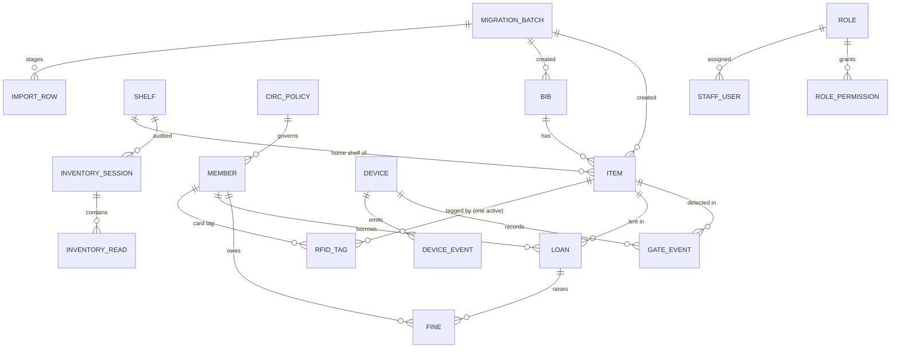

# Database Design

Column-level definitions are in `docs/01-requirements/data-dictionary.md`. This document covers structure, access control, indexing, migrations and backup.

## 1. Entity relationships

`legacy_ilms` tables (`catalogue`, `accession`, `borrower`) have no foreign keys into or out of `nexus`. The link is the soft reference `legacy_ref`, so legacy data never depends on Nexus.

## 2. Roles and grants

| DB role | Login | Grants | Used by |
|---|---|---|---|
| `nexus_owner` | yes | Owns all schemas; DDL | Alembic migrations, `ops/` tooling only |
| `nexus_app` | yes | `SELECT` on `legacy_ilms.*`; `SELECT, INSERT, UPDATE, DELETE` on `nexus.*` except `audit_log`; `SELECT, INSERT` on `nexus.audit_log`; all on `staging.*` | API and worker |
| `nexus_readonly` | yes | `SELECT` on `nexus.*` | Reporting and diagnostics |
| `legacy_owner` | no (`NOLOGIN`) | Owns `legacy_ilms` | Only the seed script, as a stand-in for the existing ILMS owner |

Consequences:
- Any `UPDATE`/`DELETE` on `legacy_ilms` from the app fails with `permission denied`. A test asserts this (NFR 01).
- `audit_log` is append-only for the app: no `UPDATE`/`DELETE` grants.

## 3. Indexing and search

| Index | Purpose |
|---|---|
| GIN on `bib.search_tsv` | Full-text OPAC search (FR 02) |
| Trigger `bib_tsv_update` (BEFORE INSERT/UPDATE) | Builds the `tsvector` from title (A weight), author (B), subjects (C), publisher/ISBN (D). Indexing is immediate on commit |
| Unique `item.accession_no`, `item.barcode`, `rfid_tag.epc` | Integrity and fast lookup |
| Partial unique `rfid_tag(item_id) WHERE status='active'` | One active tag per item |
| Partial unique `loan(item_id) WHERE returned_at IS NULL` | One open loan per item |
| `device_event.event_id` unique | Idempotent event ingest |
| B-tree on `loan(member_id, returned_at)`, `gate_event(occurred_at)`, `audit_log(occurred_at)` | Reports and dashboard |

## 4. Migrations

- Alembic, one revision per change, every revision with a working `downgrade()`.
- Revision `0001_baseline` creates the schemas, roles, grants, tables, triggers and seed reference data (roles, permissions, circulation policies).
- Each release records `(version, alembic_rev)` in `app_version`. Rollback goes to the recorded revision (ADR-0002).

## 5. Backup and restore

| Operation | Tool | When |
|---|---|---|
| Full logical backup | `pg_dump -Fc` of the whole database | Before every migration commit, before every update, and on demand |
| Restore | `pg_restore --clean --if-exists` into the same database | Rollback of a failed migration or update; AC 10 |
| Integrity fingerprint | `ops/integrity.py`: per-table row count + SHA-256 over rows ordered by primary key, for every `legacy_ilms` table | Before/after migration, update and restore; result written to `ops/reports/integrity-<ts>.json` |

Backups are written to the `backups` volume, named `nexus-<version>-<UTC timestamp>-<reason>.dump`, with a `.sha256` side file.
