# User Guide

How to use Nexus 1.0.2, by role. The screens are the staff web application at `https://<server>:<HTTPS_PORT>/` (the development stack uses `https://localhost:8443/`). All examples use the synthetic demo data: member `B00144` (category UG), lending item `ACC-000002`, reference item `ACC-000013`, shelf `A-01`, handheld `HH-01`, gate `GATE-01`, card reader `CARD-01`.

Screenshots come from the user-acceptance run and were taken at a narrow window width (about 580 px), so they show the compact layout.

## Contents

- [1. Signing in and out](#1-signing-in-and-out)
- [2. Public catalogue (OPAC)](#2-public-catalogue-opac)
- [3. Circulation Clerk](#3-circulation-clerk)
- [4. Librarian](#4-librarian)
- [5. Auditor](#5-auditor)
- [6. Admin](#6-admin)
- [7. Patron](#7-patron)
- [8. Messages you may see](#8-messages-you-may-see)

## Menu by role

The menu shows only the screens a role can use. After signing in, each user lands on the first screen in their menu.

| Screen | Admin | Librarian | Circulation Clerk | Auditor | Patron |
|---|:-:|:-:|:-:|:-:|:-:|
| Dashboard | ✔ | ✔ | | ✔ | |
| Circulation desk | ✔ | ✔ | ✔ | | |
| Catalogue | ✔ | ✔ | | | |
| Tagging | ✔ | ✔ | | | |
| Inventory | ✔ | ✔ | | | |
| Gate monitor | ✔ | ✔ | ✔ | ✔ | |
| Members | ✔ | ✔ | ✔ | ✔ | |
| Reports | ✔ | ✔ | | ✔ | |
| Devices | ✔ | ✔ | | ✔ | |
| Migration | ✔ | | | | |
| Audit log | ✔ | | | ✔ | |
| Administration | ✔ | | | | |
| System health | ✔ | | | | |
| My loans | | | | | ✔ |
| OPAC | ✔ | ✔ | ✔ | ✔ | ✔ |

Landing screen: Admin, Librarian and Auditor land on **Dashboard**, the Circulation Clerk on **Circulation desk**, a patron on **My loans**.

## 1. Signing in and out

### With a username and password

1. Open the application. If you are not signed in you are sent to **Nexus sign in**.
2. Enter your **Username or card number** (staff use their username; patrons use their library card number) and **Password**.
3. Select **Sign in**.

A wrong username or password always gives the same message, "Invalid username or password". After 10 attempts in a minute from the same address, further attempts are refused for the rest of the minute.

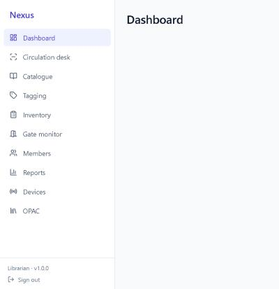

### With a staff smart card

Staff with a card registered by an administrator can sign in without a password.

1. On the sign-in page select **Tap staff card**. The button changes to "Tap your card on CARD-01…".
2. Tap the card on the reader within 60 seconds.
3. You are signed in with your own role's permissions and taken to your landing screen.

If no card is tapped within 60 seconds the page shows "No card was tapped. Please try again." An unregistered or deactivated card gives "This card is not registered to an active staff member". Patrons cannot sign in by card.

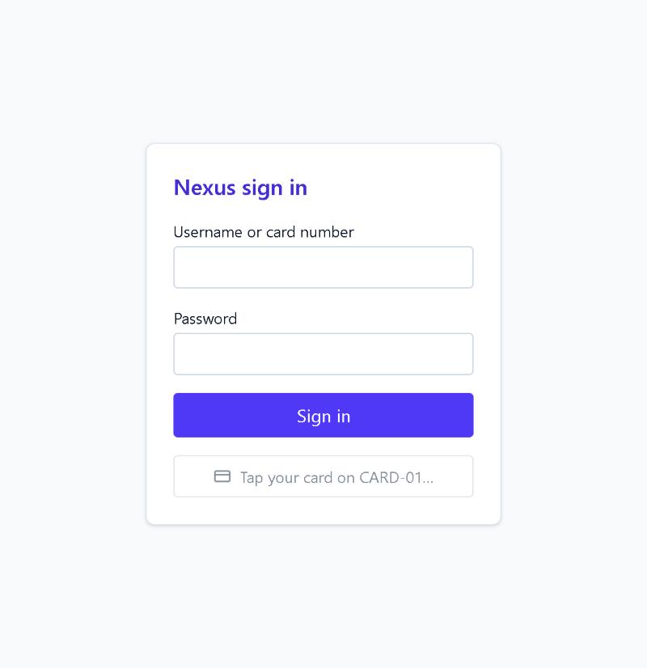

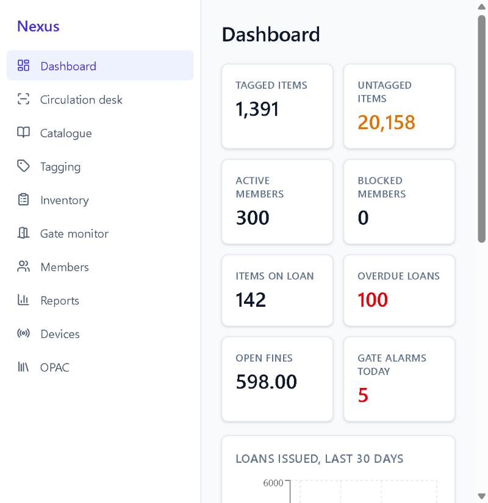

### Sessions

Sign-in tokens are kept in memory only. Reloading the page or closing the tab signs you out. While the page stays open, the 15-minute access token is renewed in the background when it expires.

## 2. Public catalogue (OPAC)

The **OPAC** (`/opac`) needs no sign-in and shows bibliographic data only.

1. Type in **Search title, author, subject or ISBN**, and optionally **Author**, **From year** and **Available now**.
2. Select **Search**. Each result shows the number of copies available and in total.
3. A shelf view (`/opac/shelves/A-01`) shows the spines on a shelf as a virtual bookshelf.

The **Staff / patron sign in** link opens the sign-in page.

## 3. Circulation Clerk

The clerk runs the circulation desk: issuing, renewing and returning items, and looking members up. The clerk sees member contact details unmasked, but cannot create or block members, catalogue, tag, settle fines or see reports.

### Issue an item (check out)

1. Open **Circulation desk**.
2. In **Member**, scan or type the card number (for example `B00144`) and select **Look up**. The member panel shows the name, status, card and category, loans against the limit ("Loans 0 / 4") and fines against the limit. Fines over the limit are shown in red.
3. In **Item**, scan or type the accession number, barcode or tag EPC (for example `ACC-000002`).
4. Select **Check out**. A green message confirms "Issued ACC-000002, due …", and the item appears under **Current loans**.

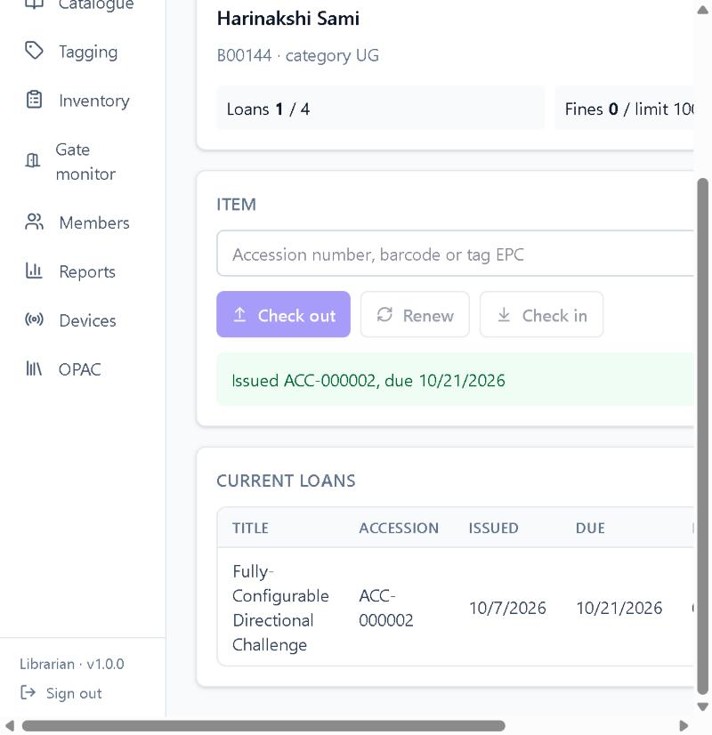

### Renew and return

- **Renew**: enter the item and select **Renew**. The message shows the new due date. A member does not need to be looked up first.
- **Check in**: enter the item and select **Check in**. If the item is overdue the message shows the fine raised ("Overdue fine raised: …").

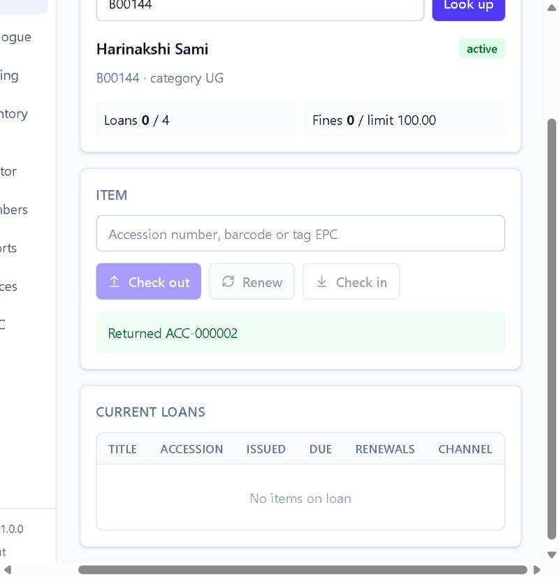

Loans made elsewhere (self-service kiosk over NCIP or SIP2) appear in **Current loans** with their channel when you look the member up again.

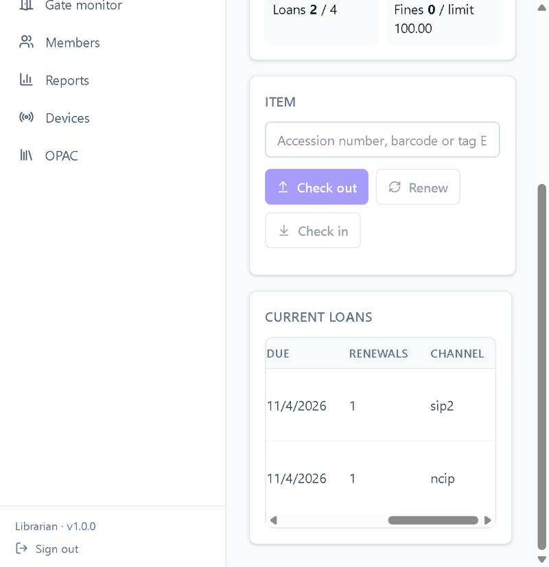

### When a loan is refused

A refused check-out or renewal shows a red banner with the reason and the code. Nothing is changed and the refusal is recorded in the audit log. For example, a reference item gives "This is a reference item and cannot leave the library" (`ITEM_REFERENCE_ONLY`). The codes are listed in [§8](#8-messages-you-may-see).

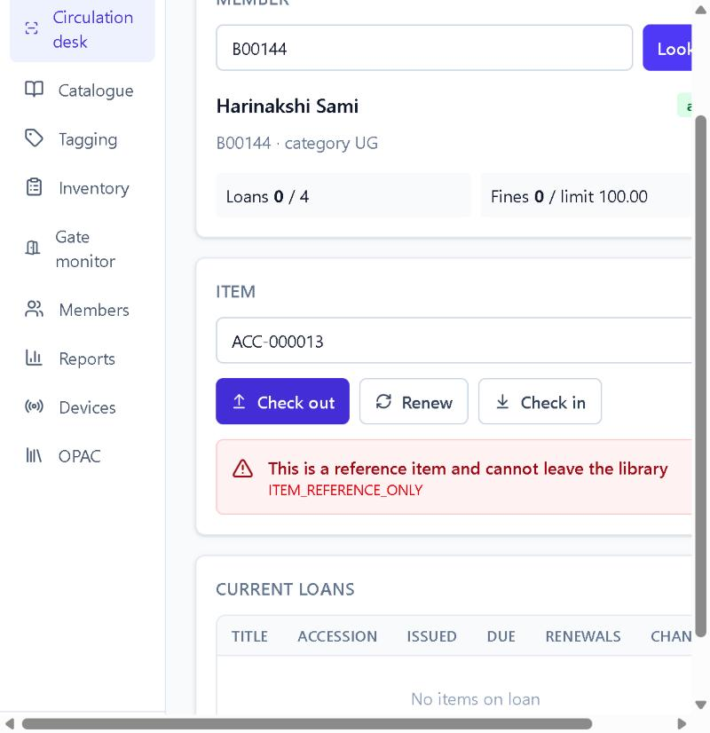

### Find a member

**Members** → type a card number or name → **Search** → **Open**. The panel shows contact details, status, loans and open fines. Block, Print card and New member are not shown to clerks.

### Watch the security gate

**Gate monitor** shows gate events as cards, newest first, and refreshes itself.
- When an alarm arrives, a red "Security gate alarm" banner appears and an alert tone plays.
- Each card shows "ALARM" or "Authorised", the direction, the accession number (or "unknown tag"), the gate, the time, the mock CCTV snapshot, and whether an email was queued.
- "decided offline" means the gate decided on its own while Nexus was unreachable, and the event was sent later.
- Clear **Alarms only** to see every passage.

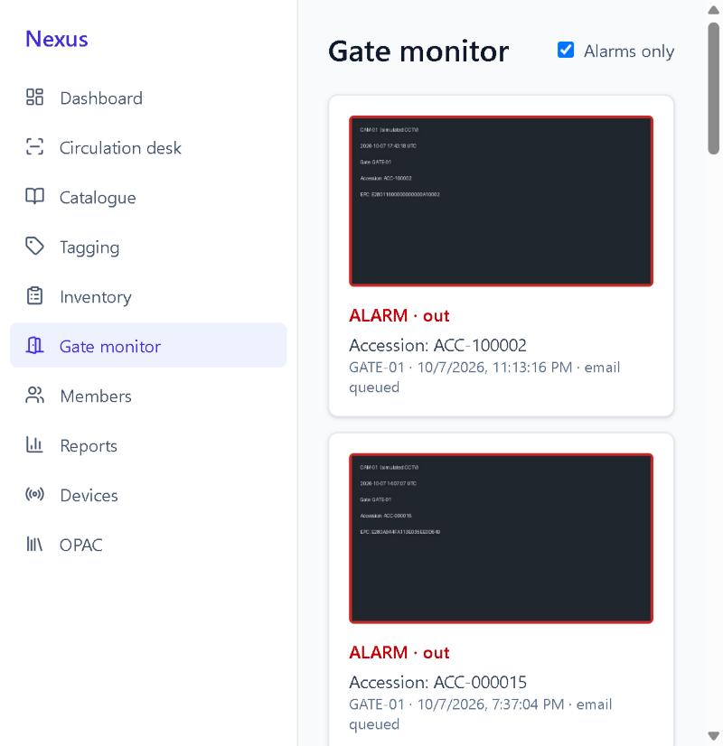

## 4. Librarian

The Librarian has everything the clerk has, plus cataloguing, tagging, inventory, member management, fines, the dashboard, reports and the device list. The Librarian cannot run migrations, read the audit log or use Administration.

### Catalogue a new record and copy

1. Open **Catalogue**.
2. Search for the title first in **Find a record** to avoid duplicates. Select an existing record with **Select**, or fill in **New bibliographic record** (title required; author, ISBN, year, publisher optional) and select **Create record**. An ISBN with a bad checksum is refused (`ISBN_INVALID`).
3. In **Add a copy of "…"**, enter the accession number (for example `ACC-000123`), barcode, call number, shelf (for example `A-01`) and type (**Lending** or **Reference only**), then select **Add item**. Accession numbers and barcodes must be unique.
4. Select **Open item** to see the item page, where **Validate for tagging** checks the record and **Spine label** downloads the label as PDF.

### Tag an item (AC 02)

1. Open **Tagging**.
2. In **1. Find the item**, enter the accession number or barcode and select **Find**. The panel shows the title, call number, shelf and status, and either "Validated: ready for tagging" or the problems found.
3. Place a blank tag on the staff-station reader (`STAFF-01`). The panel shows "Blank tag read on the staff station: …" and fills in the EPC. You can also type the EPC (8 to 32 hexadecimal characters).
4. Select **Associate** (or **Re-tag** if the item already has an active tag; the old tag is retired with the reason "retagged"). The message confirms the link and the security bit state (on, unless the item is on loan). A tag that is already registered is refused (`TAG_IN_USE`, or `TAG_RETIRED` for a retired tag).
5. **Tag-to-item relationship** lists every tag the item has had, with status, security bit and dates.

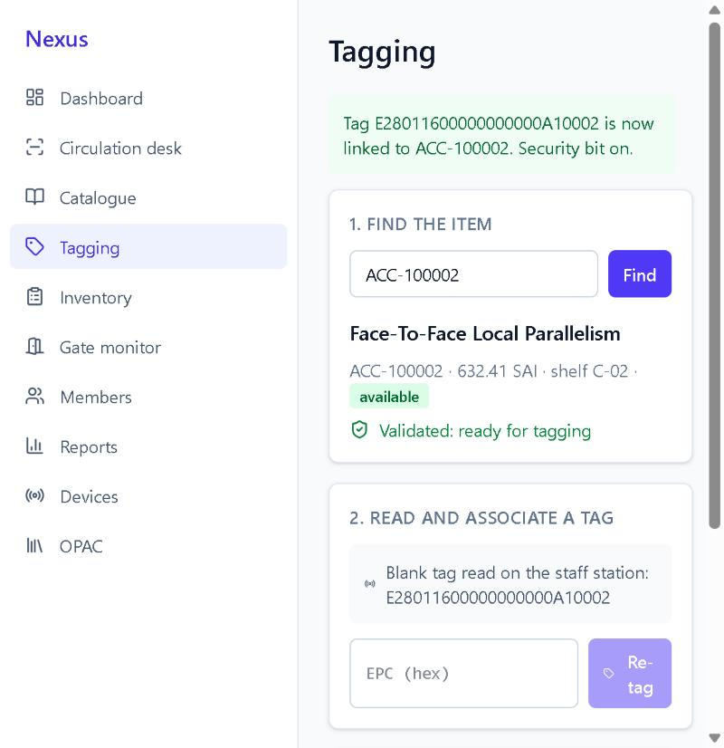

Retiring a tag on its own (for a damaged label) is available through the API only (`POST /api/v1/tags/{epc}/retire` with a reason).

### Run a shelf inventory (AC 05)

1. Open **Inventory**. Leave **Sound** ticked to hear confirmation tones.
2. Choose the **Shelf** (for example `A-01`) and the **Handheld** code (`HH-01`), then select **Start session**.
3. Sweep the shelf with the handheld. Each read appears as a tile: green for found, amber for misplaced (with the shelf it belongs on), red for unknown tags. The heading shows reads against the number expected.
4. Select **Close and report**. The summary shows Found, Misplaced, Missing and Unknown tags, with lists of missing and misplaced items. An error tone plays if anything is missing.
5. After checking the shelf by hand, select **Confirm and mark missing** to set the missing items' status to `missing`. Nothing changes until you confirm.

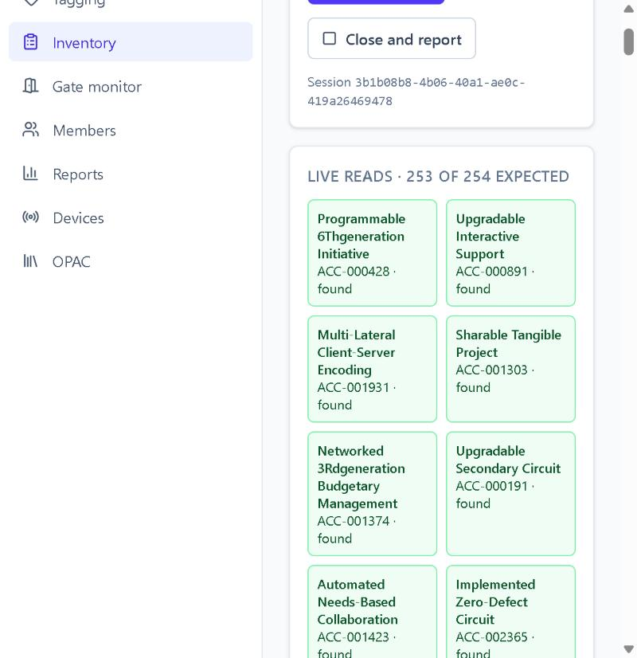

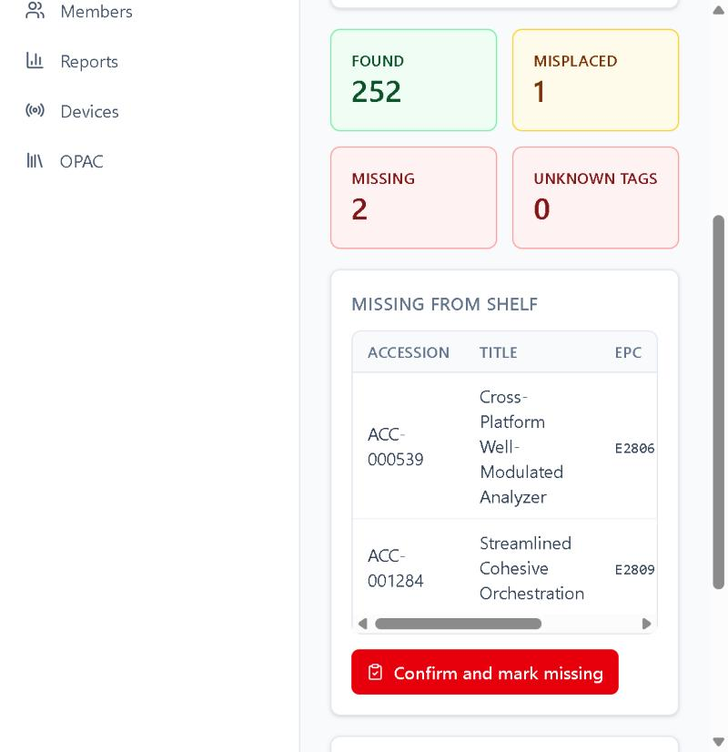

### Manage members

On **Members**:
- **New member**: card number, category (`UG`, `PG`, `FAC`, `STAFF`), full name, optional email and phone → **Create member**.
- **Block** asks for a reason; **Unblock** lifts it. A blocked member cannot borrow or renew.
- **Print card** downloads the patron card as PDF.

Editing a member's details is available through the API only (`PATCH /api/v1/members/{id}`).

### Fines

Open fines are shown on the member panel and at the desk. Settling a fine (`POST /api/v1/fines/{id}/pay`) or waiving it with a reason (`POST /api/v1/fines/{id}/waive`) is available through the API only in 1.0.2; there is no fines screen.

### Dashboard and reports (AC 08)

**Dashboard** shows tagged and untagged items, active and blocked members, items on loan, overdue loans, open fines and gate alarms today, a 30-day loans chart, the most borrowed titles and today's footfall. It refreshes every 30 seconds.

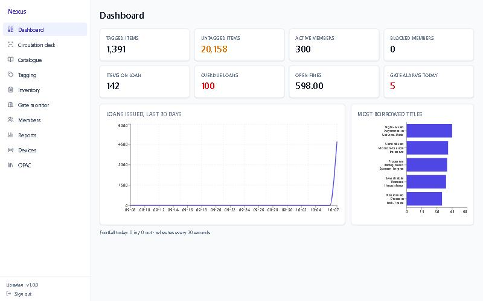

**Reports**:
1. Choose a **Report**: Tagged items, Members, Circulation, Operator activity, RFID client activity, Fines or Gate events.
2. Set **From** and **To** and any report-specific filters (for example shelf code and tag status, or alarm and device code), then select **Apply**.
3. Select **CSV** or **PDF** to download the report as shown. Reports return at most 5,000 rows.

Member email and phone are masked in reports for roles without `member.pii.read`.

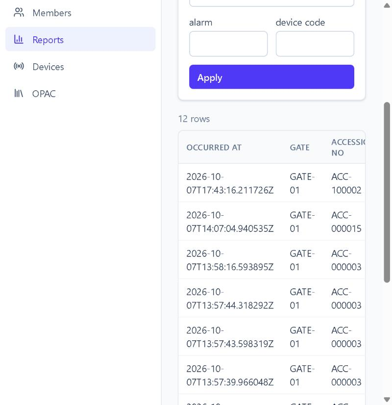

### Devices

**Devices** lists each reader, gate, camera and printer with its location, IP address, online or offline status and last heartbeat (offline after 30 seconds without an event), and below it the notification outbox (email, SMS and print messages with their status and attempts).

## 5. Auditor

The Auditor can read almost everything but change nothing: Dashboard, Gate monitor, Members (contact details masked), Reports, Devices with the notification outbox, the Audit log and the OPAC. Inventory sessions are readable through the API (`GET /api/v1/inventory/sessions/{id}`), but the Inventory screen is not in the Auditor's menu.

### Review the audit log

1. Open **Audit log**.
2. Enter the start of an action in **Action starts with** (for example `circulation.` for all circulation events, or `auth.login.failure`), and optionally **From** and **To**.
3. Select **Filter**. Each entry shows the time, actor type and id, action, entity, details and IP address. Use **Previous** and **Next** to page.

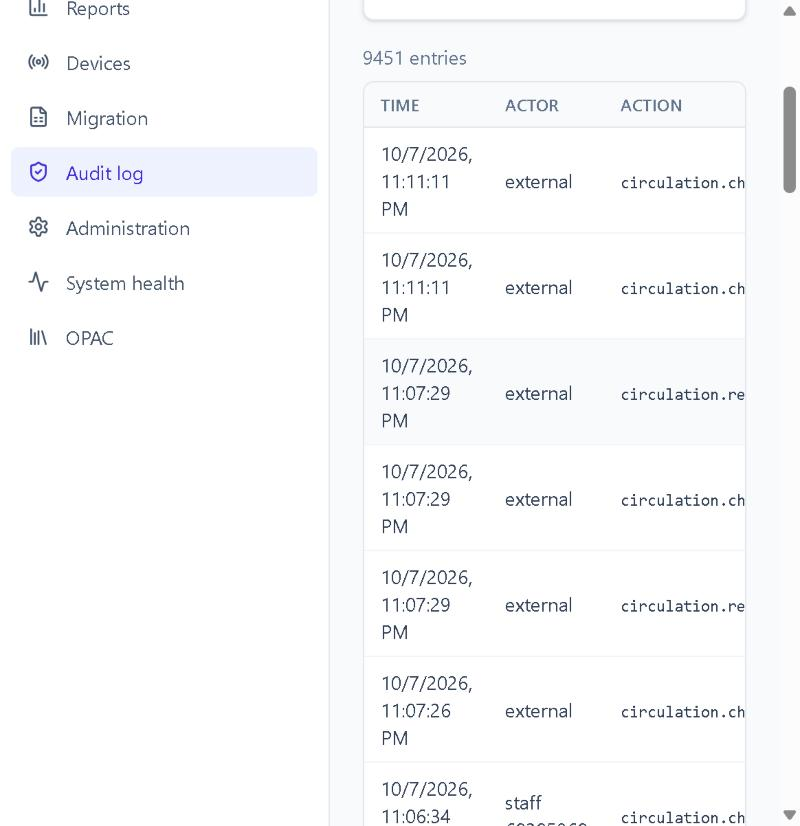

The list of actions is in the [administrator guide](administrator-guide.md#8-audit-review).

### Reports and exports

As for the Librarian ([§4](#dashboard-and-reports-ac-08)). Member email and phone appear masked (`***`) in member reports and exports.

## 6. Admin

The Admin has every permission and sees every screen. Tasks specific to the role:

- **Administration**: create staff users, activate or deactivate them, and edit circulation policies. See the [administrator guide](administrator-guide.md#2-staff-users).
- **Migration**: stage, validate, commit and roll back spreadsheet imports.
- **Audit log**: as for the Auditor.
- **System health**: database check, application version, database revision and licence status. While a check is failing the screen does not show the current result (see the [administrator guide](administrator-guide.md#10-health-and-version)).

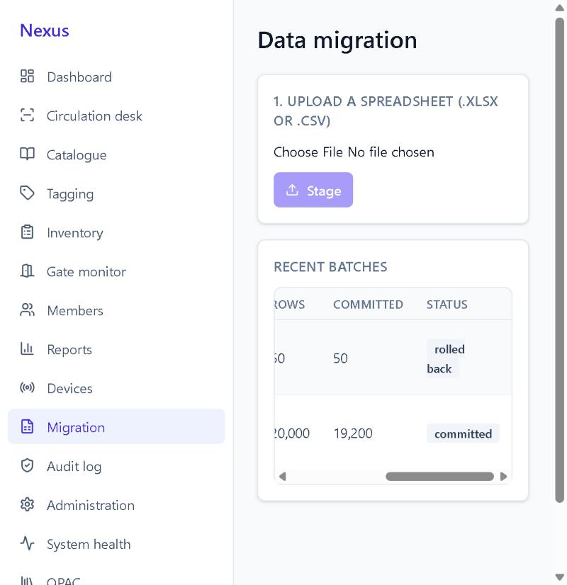

Settings, device registration and key rotation, role changes and NCIP agencies have no screen in 1.0.2; the [administrator guide](administrator-guide.md) gives the API calls.

## 7. Patron

Patrons sign in on the same page with their **library card number** and password, then see **My loans** and the **OPAC**.

### My loans

- The table lists each item on loan with its title, accession number, due date (red when overdue) and number of renewals.
- **Renew** extends a loan if the rules allow. A refusal shows a red banner with the reason, for example "This loan has been renewed the maximum number of times".
- **Fines** lists the member's fines with date, amount, reason and status.

A patron can see only their own loans and fines; requests for another member's records are refused. There are no patron screenshots in the evidence set.

## 8. Messages you may see

Refusals shown at the desk, on My loans and in the red banners:

| Code | Message on screen |
|---|---|
| `ITEM_REFERENCE_ONLY` | This is a reference item and cannot leave the library |
| `MEMBER_BLOCKED` | This member is blocked from borrowing |
| `MEMBER_EXPIRED` | This membership has expired |
| `FINE_LIMIT_EXCEEDED` | Outstanding fines exceed this member's limit |
| `MAX_ITEMS_REACHED` | The member already has the maximum number of items |
| `MAX_RENEWALS_REACHED` | This loan has been renewed the maximum number of times |
| `ITEM_NOT_AVAILABLE` | This item is not available for loan |
| `ITEM_NOT_ON_LOAN` | This item is not on loan |
| `MEMBER_NOT_FOUND` | No member with that card number |
| `ITEM_NOT_FOUND` | No item with that accession number, barcode or tag |
| `ERR_FORBIDDEN` | Not permitted (your role does not allow the action) |
| `LICENCE_REQUIRED` | This installation is not activated … Until then it is read-only. Contact an administrator |

Other codes are listed in the [API guide](api-guide.md#3-error-codes).
